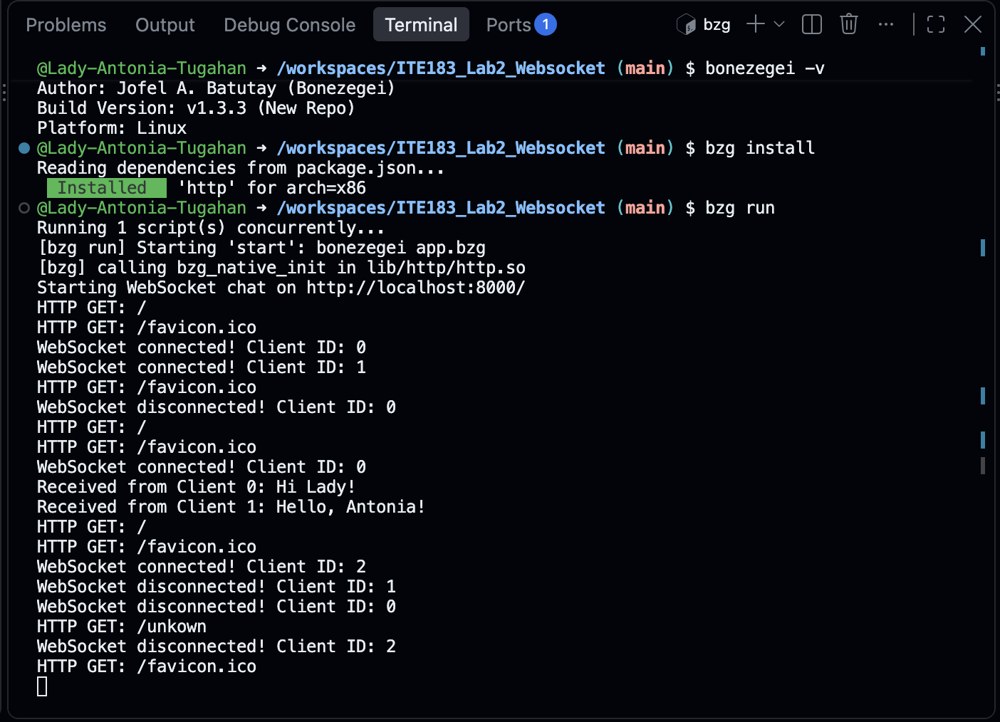
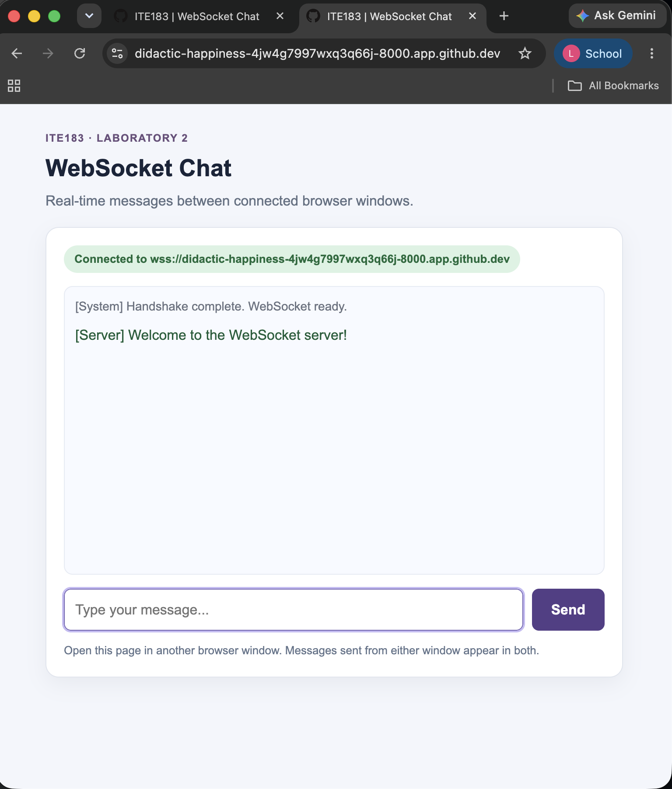
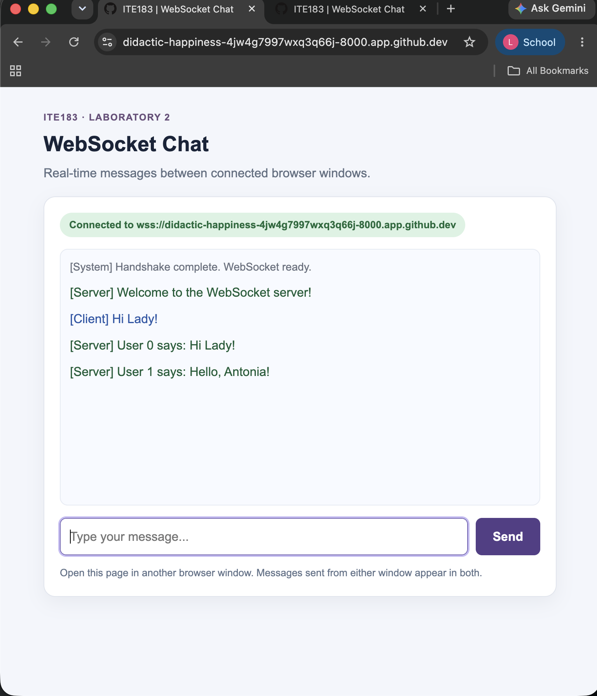
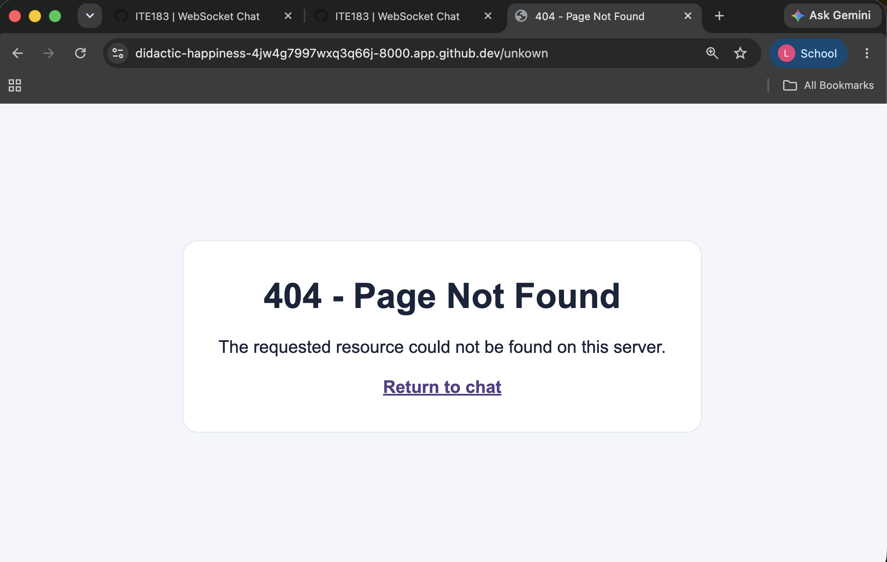

# BSL WebSocket Server

A WebSocket chat server built using Bonezegei Scripting Language (BSL) and the BSL HTTP Library for ITE183 Laboratory 2.

## Project Description

The application serves a browser-based chat client and allows multiple clients to exchange messages in real time. The WebSocket server listens on port `8000`, sends a welcome message when a client connects, broadcasts received messages to all active clients, and logs disconnections. HTTP requests to `/` display the chat page, while other paths display a custom 404 page.

## Technologies Used

- Bonezegei Scripting Language v1.3.3
- BSL HTTP Library
- HTML, CSS, and JavaScript
- HTTP and WebSocket
- Git and GitHub
- Visual Studio Code or GitHub Codespaces

## Project Structure

```text
ITE183_Lab2_Websocket/
├── documentation/
│   ├── broadcast_client1.png
│   ├── broadcast_client2.png
│   ├── client_connected.png
│   ├── custom_404.png
│   └── server_running.png
├── lib/
│   ├── http/
│   │   └── http.so
│   ├── http.bzg
│   └── http.json
├── public/
│   ├── 404.html
│   └── index.html
├── .gitattributes
├── LICENSE
├── README.md
├── app.bzg
└── package.json
```

The `lib/` files are installed by the Bonezegei package manager. The `documentation/` PNG files are screenshots captured during testing.

## Installation and Setup

### 1. Install Bonezegei

Install Bonezegei v1.3.3 in a supported Windows or Linux environment. For Linux-based GitHub Codespaces, use the Bonezegei release provided in the laboratory instructions. Verify the version:

```bash
bonezegei -v
```

### 2. Install the HTTP library

From the project directory, run:

```bash
bzg install
```

### 3. Run the WebSocket server

```bash
bzg run
```

Open `http://localhost:8000/` in a browser. In Codespaces, open the forwarded port `8000` URL. The client automatically uses `ws://` on HTTP sites or `wss://` on HTTPS sites.

## Server Implementation

The `app.bzg` file initializes an HTTP server on port `8000` and handles the following events:

- `server.get` serves the homepage and custom 404 page.
- `server.onConnect` records a client connection and sends a welcome message.
- `server.onData` receives a client message and broadcasts it using `server.sendAll()`.
- `server.onDisconnect` records when a client disconnects.

The `public/index.html` file contains the WebSocket chat interface, connection status, message input, Send button, and message log.

## Results and Documentation

### 1. Server Running

The server runs with `bzg run` and listens on port `8000`.



### 2. Client Connected

The browser establishes a WebSocket connection and displays a welcome message.


### 3. Broadcast from Client 1

Client 1 sends a message, which the server broadcasts to active connections.



### 4. Broadcast Received by Client 2

Client 2 receives the message sent by Client 1 without refreshing the page.



### 5. Custom 404 Page

The server displays the custom 404 page when an undefined route is requested.



## Conclusion

This activity demonstrates how a WebSocket server supports real-time communication between connected browser clients. The server manages connections, receives messages, broadcasts them to active clients, and handles disconnections. It also serves the chat interface and a custom page for undefined HTTP routes.

## License

This project is licensed under the MIT License.
